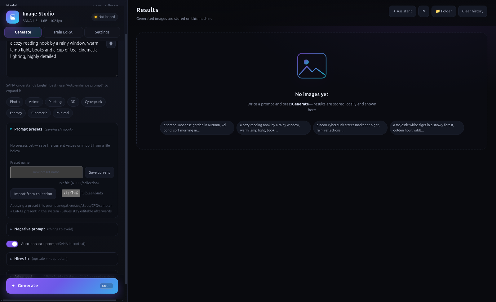
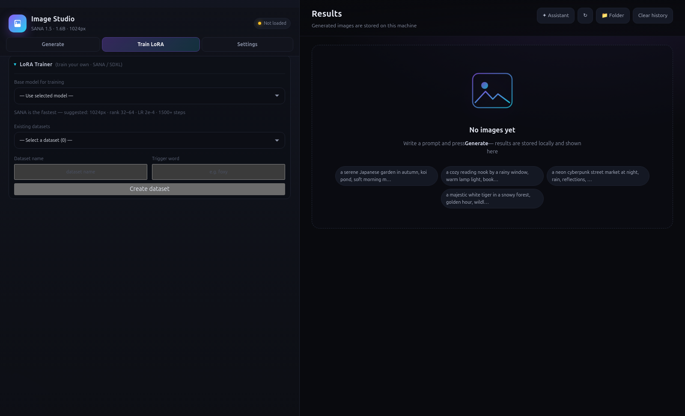
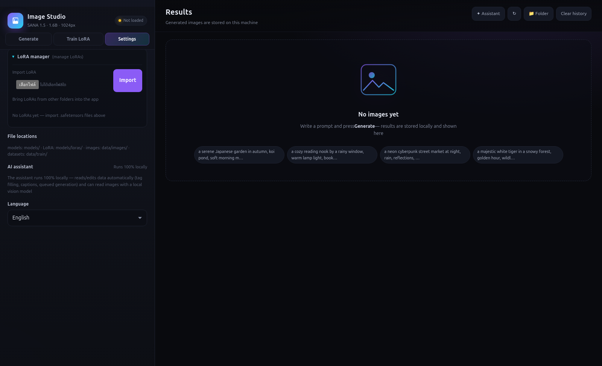
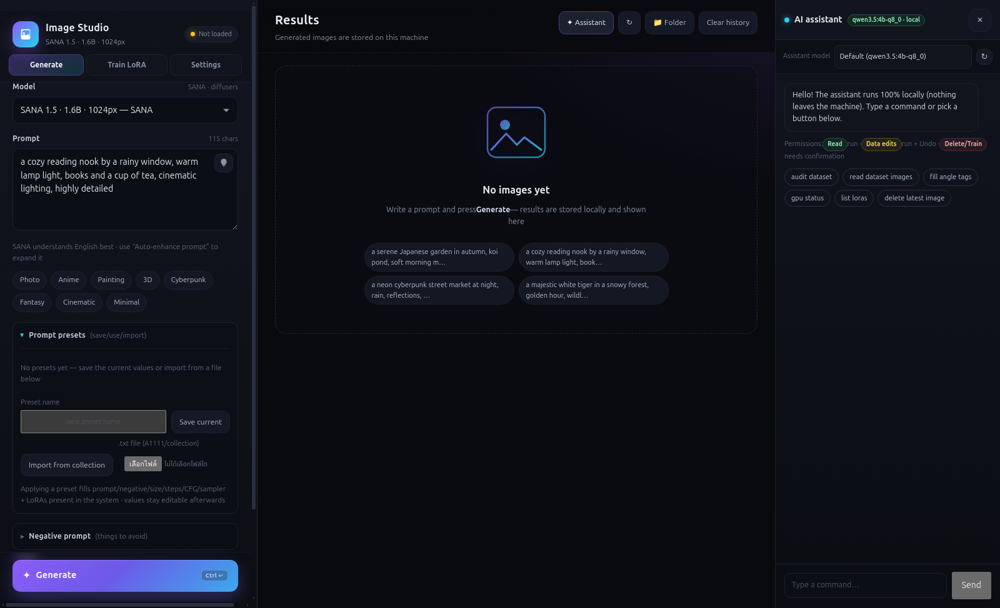
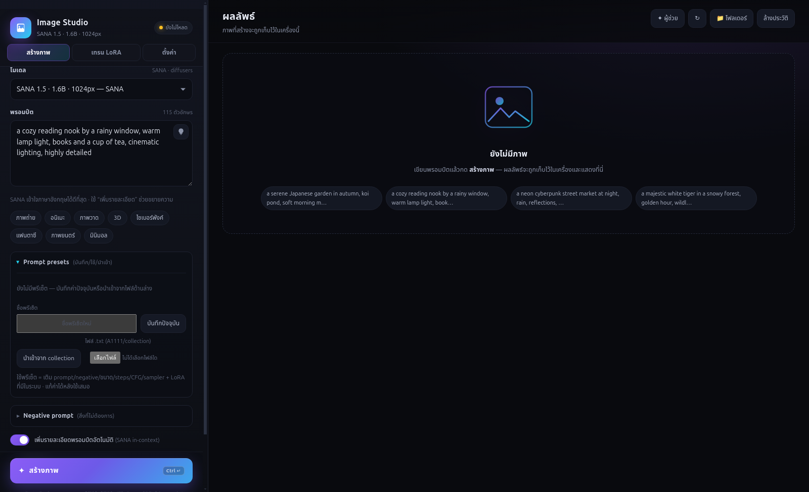

# PixelSmith Image Studio

A local-first desktop app for AI image generation, powered by **SANA 1.5 · 1.6B ·
1024px** with optional **SDXL / SD 1.5** support (diffusers pipelines or single
`.safetensors` checkpoints) and **LoRA** adapters.

Everything runs on your machine: no account, no cloud API, no telemetry. The UI
is served by a local Python engine on loopback and wrapped in an Electron
window. The interface is available in **English and Thai**.

## Screenshots

| | |
|---|---|
|  |  |
|  |  |
|  | *Captured in a clean demo workspace — no personal images or LoRAs.* |

## Features

- **Multiple model families** — switch between SANA / SDXL / SD 1.5 from the UI.
  The engine frees VRAM when switching and reloads lazily.
- **LoRA support** — stack adapters with per-LoRA weights (0–2), filtered by
  model family.
- **Train your own LoRA (SANA / SDXL)** — create a dataset, import images,
  write captions, choose the base model, set rank/steps/LR and queue training.
  SANA uses flow-matching; SDXL trains a DDPM LoRA on the UNet. Results are
  packed as ready-to-use `.safetensors` files with metadata.
- **Regional prompting (SDXL)** — split the prompt across left/center/right or
  a 2×2 grid. Useful for multi-character scenes and precise composition.
- **Inpainting (SDXL)** — edit a masked region.
- **Hires fix (SANA / SDXL / SD 1.5)** — generate at a base size, then upscale
  and refine (1–2×, adjustable denoise).
- **ESRGAN upscale** — upscale any image in the lightbox with Real-ESRGAN ×4
  (pure PyTorch, tiled for small GPUs). The 64 MB model downloads once on first
  use; the result is saved to history with the source prompt and metadata.
- **Job queue** — queue up to 8 generations, reorder with ▲▼, cancel individual
  jobs with ✕.
- **Prompt presets** — save prompt + negative + size/steps/CFG/sampler/LoRA
  from the current form, then re-apply with one click (including model and LoRA
  weights). Import A1111/Forge `parameters` blobs or collection-style text.
  Stored in `data/prompt_presets.json`.
- **Bilingual UI (English / Thai)** — switch under **Settings → Language**.
  First launch follows the OS locale and the choice is remembered. The built-in
  assistant replies in the UI language.
- **Text-to-image** — negative prompt, seed, batch (1–4), steps, CFG, sampler
  (DPM-Solver / Euler).
- **Prompt helpers** — style presets, random ideas, and an optional
  "add detail" pass (SANA in-context prompt enhancement).
- **Image sizes** — common aspect ratios or custom sizes (multiples of 32,
  256–2048).
- **Gallery + history** — every batch is stored locally; inspect details, reuse
  settings, download or delete.
- **Lightbox** — browse a batch with arrow keys, click the prompt to copy it.
- **Local AI assistant (optional)** — chat commands and status queries, plus
  local vision image reading through [Ollama](https://ollama.com). Choose the
  assistant model in the drawer; the choice is remembered.
- **LoRA manager** — import LoRAs from other folders, remove them, inspect size
  and family.
- **Live progress** — polling updates, cancellable jobs, VRAM display.
- **Metadata** — generated PNGs embed prompt/seed/size/steps plus a WebP
  thumbnail.
- **Host page** — load/unload the model, open folders, and inspect logs.

## Requirements

| | |
|---|---|
| GPU | NVIDIA (≥ 8 GB VRAM recommended; tested on a 10 GB Pascal card) |
| RAM | ≥ 12 GB (model load/conversion needs more than generation) |
| Disk | ~16 GB free (torch + CUDA libs ~5 GB, model ~9 GB, images) |
| Python | 3.10 – 3.12 |
| Node | 18+ (for Electron) |
| Other | One-time internet access, NVIDIA driver with CUDA 12.1 support |

## Install

### AppImage (recommended for new machines)

Download `PixelSmith-Image-Studio-1.4.0-x86_64.AppImage` from the
[Releases](../../releases) page and make it executable:

```bash
chmod +x PixelSmith-Image-Studio-1.4.0-x86_64.AppImage
./PixelSmith-Image-Studio-1.4.0-x86_64.AppImage
```

On first launch the app **installs everything automatically** and shows
progress in-app:

1. Creates a Python environment and installs the engine packages
   (torch ~5 GB).
2. Downloads the default **SANA 1.5 · 1.6B · 1024px** model (~9 GB).
3. Starts the engine and opens the studio.

All data (models, venv, images, datasets) lives in
`~/.local/share/PixelSmithImageStudio`. Override with the `IMGS_HOME`
environment variable. Internet is only required for the first launch; if an
install is interrupted, relaunching resumes from where it stopped.

> Build the AppImage yourself: `cd electron && npx electron-builder --linux AppImage`

### From source (development)

```bash
git clone <this-repo> pixel-image-studio
cd pixel-image-studio

# 1) Engine + model (~14 GB: torch + CUDA libs ~5 GB, model ~9 GB)
bash engine/setup.sh

# 2) Launch (installs Electron ~100 MB on first run)
bash electron/linux-setup.sh
```

If you already have `SANA1.5_1.6B_1024px.pth`, save bandwidth:

```bash
bash engine/setup.sh --from-pth "/path/to/SANA1.5_1.6B_1024px.pth"
```

Check the environment without installing anything:

```bash
bash engine/setup.sh --check
```

Other launch helpers:

```bash
bash electron/launch.sh             # launch directly (already installed)
bash electron/create-launcher.sh    # create a desktop/menu launcher (once)
engine/.venv/bin/python engine/server.py   # headless engine for debugging
# open http://127.0.0.1:47824/
```

## Usage

1. Choose a **model** at the top of the form (SANA / SDXL / SD 1.5). Size,
   steps and CFG follow the model.
2. If you have LoRAs, open the **LoRA** section and pick adapters (weights
   0.5–1.0 work well).
3. Optionally enable **Regional prompt** / Inpaint (SDXL) or **Hires fix**
   (SANA / SDXL / SD 1.5).
4. Type an English prompt (SANA understands English best). Use the style
   buttons to append presets.
5. Pick size/aspect ratio, steps, CFG and seed (`-1` = random).
6. Press **Generate**. The first run loads the model and takes longer.
7. Results appear in the gallery and are stored in `data/images/`. Open the
   lightbox to view, download, or reuse settings.

> The first generation loads the model into memory automatically. Use
> **Free VRAM** in the top bar to release it when idle.

> Measured on an NVIDIA P102-100 10 GB (CPU offload): SANA 1024×1024 / 8 steps
> ≈ 37 s, 768×768 / 8 steps ≈ 40 s (warmup on first run), 512×512 / 6 steps
> ≈ 20 s; SANA load ≈ 8–12 s. Single-file SDXL 512×512 / 6 steps ≈ 30 s; load
> ≈ 14 s. LoRAs add a few seconds of load time and are cached until the set
> changes.

> To use models/LoRAs already on disk (e.g. from A1111/Forge), edit
> `models/dirs.json` with `model_dirs` / `lora_dirs`, or set the
> `IMGS_MODEL_DIRS` / `IMGS_LORA_DIRS` environment variables, then reload the
> app. `.safetensors` files are discovered automatically.

## Train a LoRA (SANA / SDXL)

1. Open the **Train LoRA** tab, create a dataset and import images (or reuse an
   existing one).
2. Choose the **base model** — SANA or SDXL installed on your machine.
3. Write captions (the trigger word is added automatically) and mark images as
   solo or multi-character.
4. Set the LoRA name, rank, steps, LR and resolution, then start. Training
   joins the same queue as generation.
5. The output file appears in the LoRA list with its family tag (SANA/SDXL)
   and is ready to use.

**SANA** uses flow-matching on a transformer (fast). Defaults: 1024px,
rank 32, LR 2e-4, 1500 steps.

**SDXL** trains only the UNet with a PEFT LoRA (attention q/k/v/out) plus
gradient checkpointing. VAE/text encoders are loaded once to cache
latents/embeddings, then released. Defaults: 768px, rank 16, LR 1e-4,
1000 steps.

> Measured on a P102-100 10 GB (8-image dataset, rank 4): SDXL
> **512px ≈ 2.8 s/step · 768px ≈ 2.2 s/step · 1024px ≈ 4.2 s/step** → 1000
> steps at 768px ≈ 35–40 min (higher rank is slightly slower). SANA is several
> times faster.
>
> Training runs one job at a time. The engine automatically unloads the
> generation pipeline and the assistant LLM before training starts.

## Local AI assistant (optional)

The assistant uses a local LLM through [Ollama](https://ollama.com) — no cloud,
no API key, and images never leave the machine. Without Ollama the app still
generates images; the assistant falls back to a rule-based brain.

```bash
# 1) Install Ollama and start the service (usually starts automatically).
# 2) Pull the default model (supports chat / vision / tools).
ollama pull qwen3.5:4b-q8_0
```

**Choosing a model in the app**

1. Click **✦ Assistant** in the top-right to open the drawer.
2. The **Assistant model** bar lists Ollama models installed on the machine.
3. Pick one — the choice is saved to `data/assistant_config.json` (the
   "default" option is `qwen3.5:4b-q8_0`).
4. Press **↻** to rescan after installing or removing Ollama models.

Notes:

- Models without `completion` cannot be selected. Models without `vision` can
  chat and run tools, but "read images" is unavailable (the bar warns you).
- You cannot switch models while an image read is in progress (wait or stop
  first).
- Setting `IMGS_ASSIST_MODEL` locks the choice (the API returns 409).
- VRAM is shared with SANA: the LLM is unloaded before generation/training, and
  SANA is unloaded before talking to the assistant if it is loaded.
- Other env vars: `IMGS_ASSIST_BRAIN=auto|llm|rules`,
  `IMGS_OLLAMA_URL` (default `http://127.0.0.1:11434`),
  `IMGS_ASSIST_TIMEOUT` (seconds, default 90).

## Project structure

```
image-studio/
├── engine/                  # Python engine
│   ├── sana_engine.py       # model loading, generation, PNG/thumbnail, .pth conversion
│   ├── sana_trainer.py      # SANA LoRA trainer + dataset registry/captions
│   ├── sdxl_trainer.py      # SDXL LoRA trainer (UNet, DDPM)
│   ├── assistant.py         # tool registry + rule brain + undo store
│   ├── assistant_llm.py     # LLM brain (Ollama) + model selection
│   ├── assistant_vision.py  # local vision (image reading/tagging) via Ollama
│   ├── server.py            # FastAPI: API + web/file serving
│   ├── prepare_model.py     # model download/conversion (called by setup.sh)
│   ├── requirements.txt
│   ├── setup.sh
│   └── .venv/               # created by setup.sh
├── studio/                  # generation UI
│   ├── index.html
│   ├── style.css
│   ├── app.js
│   └── i18n.js
├── host/                    # desktop shell (top bar + iframe)
│   ├── index.html
│   └── setup.html
├── electron/                # window + engine launcher
│   ├── main.js
│   ├── preload.js
│   ├── package.json
│   ├── launch.sh
│   ├── linux-setup.sh
│   ├── create-launcher.sh
│   └── icon.png / icon.ico
├── models/                  # SANA + other models/LoRAs (git-ignored)
│   ├── dirs.json            # external model/LoRA folders
│   └── loras/               # drop your own LoRAs here
└── data/                    # created automatically (git-ignored)
    ├── images/              # generated PNGs
    ├── thumbs/              # WebP thumbnails
    ├── history.json         # history (up to 800 batches)
    └── engine.log           # engine log
```

## Architecture

- **engine** (`engine/server.py`) is a FastAPI app bound to
  `127.0.0.1:47824` only, serving everything from a single origin:
  - `/` → `host/index.html` (desktop shell)
  - `/studio/` → the generation UI
  - `/files/` → PNGs + thumbnails under `data/`
  - `/api/*` → JSON API
- **electron** (`electron/main.js`) spawns
  `engine/.venv/bin/python engine/server.py`, waits for `/api/health`, then
  loads `http://127.0.0.1:47824/`. If the engine cannot start, it shows an
  in-app setup guide.
- Generation jobs run one at a time on a worker thread; the UI polls
  `/api/jobs/{id}` every 0.8 s.
- Models load lazily on the first generation. CPU offload is used, falling back
  to sequential offload.
- Models are discovered under `models/`, `models/checkpoints/` and folders in
  `models/dirs.json` (or `IMGS_MODEL_DIRS` / `IMGS_LORA_DIRS`), supporting both
  diffusers directories and single `.safetensors` files.
- Supported families: `sana` (bf16), `sdxl` (fp16), `sd15`. Flux is not
  supported (too heavy for 10 GB).
- LoRAs use diffusers `load_lora_weights` / `set_adapters` with caching of the
  active set.
- Regional prompting (SDXL) splits prompts across UNet cross-attention zones
  (left/right, left/center/right, 2×2) to keep characters from blending.
- Hires fix runs in two passes — base t2i → LANCZOS upscale → low-denoise
  img2img:
  - SANA: diffusers has no `SanaImg2ImgPipeline`, so the denoise loop is
    implemented in `_sana_hires_refine` (always wrapped in `@torch.no_grad()` to
    avoid leaking activations into VRAM), reusing the same pipeline.
  - SDXL / SD 1.5: pipelines are loaded per mode (`ensure_ready(kind="img2img")`)
    to keep RAM in check on 15 GB machines without swap.
- UI settings live in `localStorage` for that origin (fixed port keeps them
  stable).

### API summary

| Method | Path | Purpose |
|---|---|---|
| GET | `/api/health` | engine/model/GPU/VRAM status |
| GET | `/api/models` | model list + default |
| POST | `/api/models/select` | switch model (`{id}`) — frees VRAM |
| GET | `/api/loras` | LoRA list + compatible families |
| POST | `/api/model/load` | preload model (async) |
| POST | `/api/model/unload` | free memory |
| POST | `/api/generate` | create job → `{job_id}` (supports `regions`/`hires`); up to 8 queued |
| GET | `/api/jobs?active=1` | active jobs in run order |
| GET | `/api/jobs/{id}` | progress + images |
| POST | `/api/jobs/{id}/cancel` | cancel (also removes queued jobs) |
| POST | `/api/jobs/{id}/move?direction=up\|down` | reorder queue |
| GET | `/api/history?offset=&limit=` | history |
| DELETE | `/api/history/{id}` | delete a batch + files |
| POST | `/api/history/clear` | clear everything (`delete_files`) |
| POST | `/api/open-folder?which=images` | open a folder |
| GET | `/api/log?tail=200` | recent log |
| GET | `/api/train/datasets` | datasets + captions/audit |
| POST | `/api/train/datasets` | create dataset (`{name, trigger, kind}`) |
| POST | `/api/train/datasets/{id}/train` | queue LoRA training (`model_id` selects SANA/SDXL) |
| GET | `/api/presets` | list prompt presets |
| POST | `/api/presets` | create a preset |
| PUT | `/api/presets/{id}` | update a preset |
| DELETE | `/api/presets/{id}` | delete a preset |
| POST | `/api/presets/import` | import from text/file |
| GET | `/api/assistant/models` | installed Ollama models + selected assistant model |
| POST | `/api/assistant/model` | select assistant model (`{model}`; `""` = default) |

## Tests

```bash
engine/.venv/bin/python -m pytest tests
```

179 tests (a few seconds) covering model/LoRA discovery, family detection,
regional/hires logic, SANA/SDXL trainers (sanitize, save format, resume,
thermal, multi-character), assistant tools, prompt presets, and the full API
(validation, queue ordering/move/cancel/limits). Tests stub `generate` so no
real model is loaded and use a temporary data directory.

## Troubleshooting

**First run is very slow / stuck at "preparing model"**
It is downloading ~9 GB once. Check `data/engine.log` or `/api/log`.

**CUDA out of memory**
- Lower the image size (e.g. 768×768) or set batch to 1.
- Close other VRAM-hungry apps.
- CPU offload is already enabled; if it is still not enough, press **Free VRAM**
  and retry.
- 2048px needs a lot of VRAM and is not recommended on 10 GB cards.

**Generation is slow**
- SANA is fast at low step counts (8–20); raise steps only when needed.
- Pascal has no tensor cores; bf16 is still faster than fp32.
- The first run includes model load time.
- SDXL is much slower than SANA (UNet + 2 text encoders) — start at
  512–768px / 20–25 steps.

**LoRA fails to load**
- A LoRA must match the model family (SDXL with SDXL, SD 1.5 with SD 1.5).
- SANA LoRAs must be in diffusers format; many community `.pth`/kohya files
  will not work.
- Try weights 0.5–0.8 and verify the `.safetensors` file is not corrupted.

**Regional prompt does not work**
- SDXL only; SANA and SD 1.5 are not supported.
- Enable Regional prompt in the form and select an SDXL model.
- Keep each zone prompt short (≤ 200 characters).
- If results are poor, reduce the number of zones or increase the weight
  difference.

**App will not open (Linux)**
```bash
# Ubuntu 24.04 / Mint 22 often block the sandbox
sudo chown root:root electron/node_modules/electron/dist/chrome-sandbox
sudo chmod 4755 electron/node_modules/electron/dist/chrome-sandbox
# or temporarily
cd electron && ./node_modules/.bin/electron . --no-sandbox
```

**Port 47824 is in use**
An old engine is still running. Stop it or run
`pkill -f 'engine/server.py'`.

**"Engine is not installed"**
Run `bash engine/setup.sh` (or `--from-pth`), then reopen the app.

**Check logs**
Use the **log** button in the top bar, or open `data/engine.log`.

## Building the AppImage

```bash
bash electron/linux-setup.sh dist
```

`electron-builder` bundles `engine/`, `studio/` and `host/` into the app but
**excludes** `.venv` and models (large and machine-specific). The target
machine installs them on first launch (see the AppImage section above).

## License

[MIT](LICENSE)
